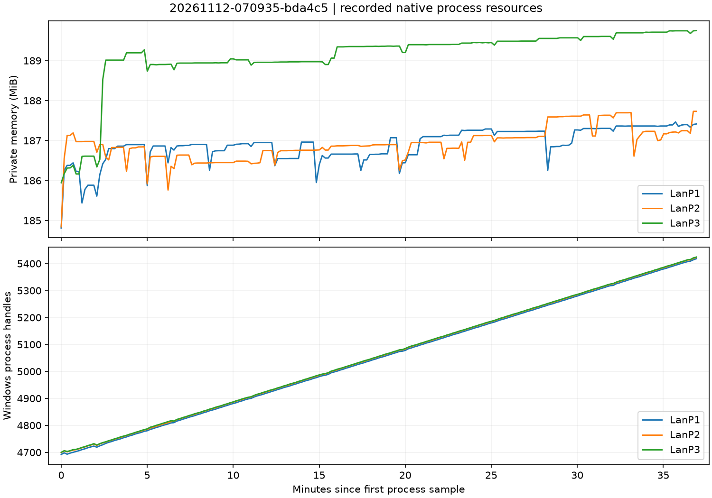
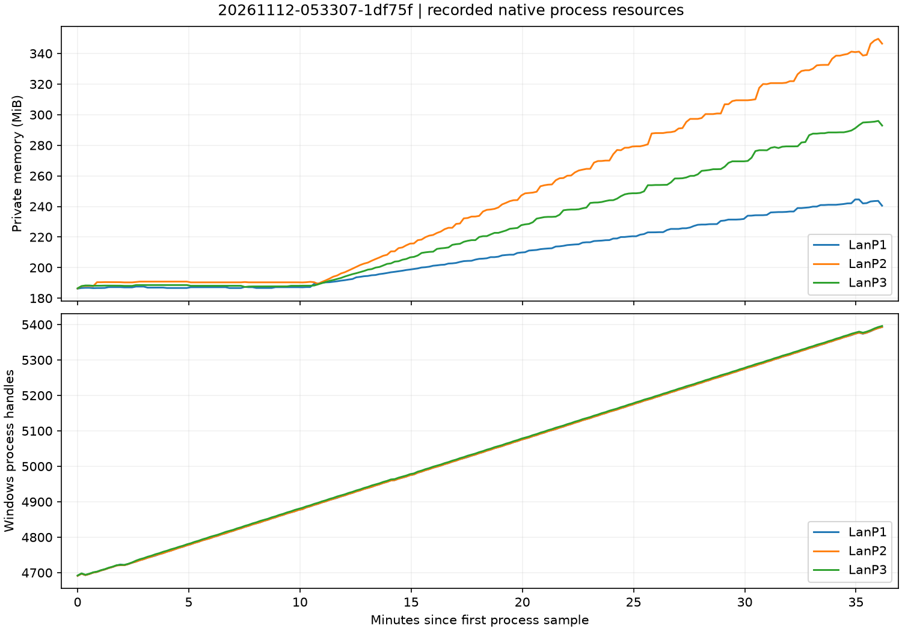
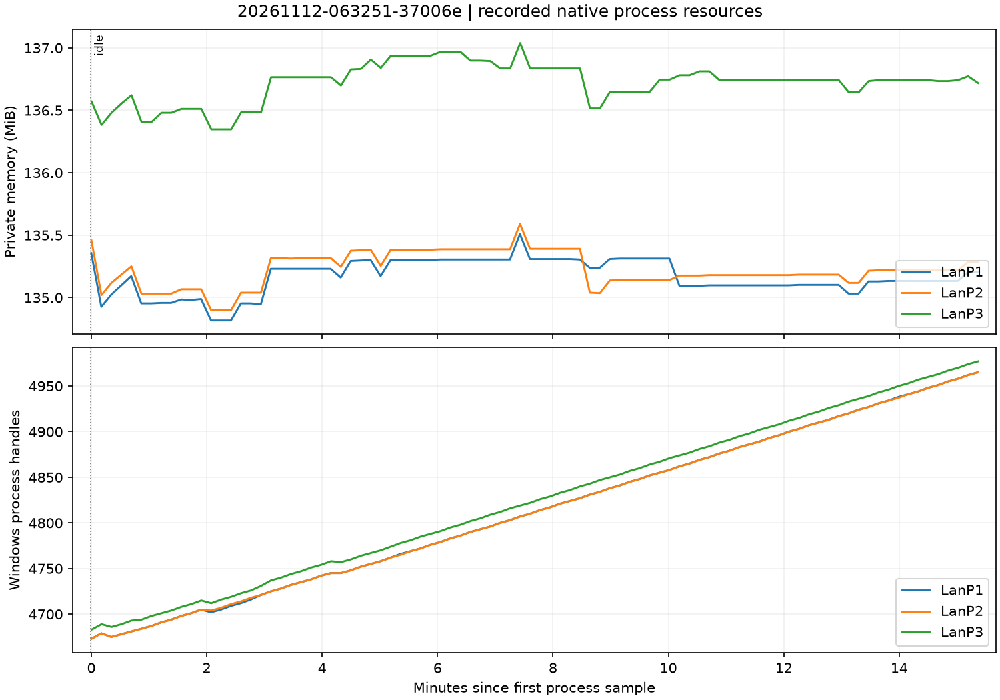
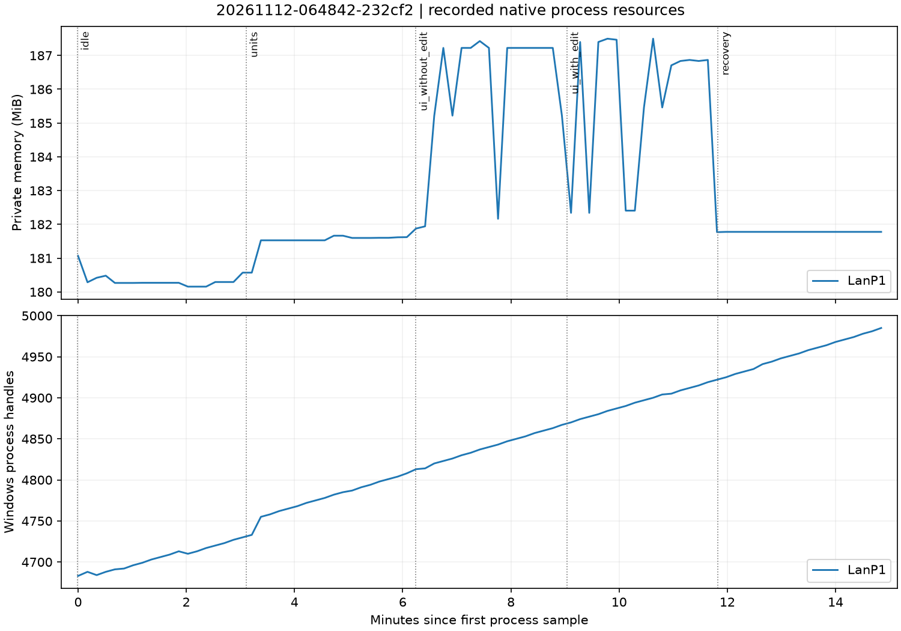

# 扩展研究与最终实机验证（2026-11-12）

本报告对应八项长任务的扩展实现。旧《实机验证报告》保留原始基线历史；不能用旧成绩替代本报告的最终源码验证。运行时仍固定 InnerJAPI 1.49-9、Lua 5.3、handle_level 0、Warcraft 安装目录的 1.27.0.52240 环境。一机多进程 LAN，不等于跨机、平台房间或真实玩家网络环境。

## 最终源码回归集合

终审源码的全部必需构建已验收，独立证据校验通过。

| 构建 / 会话 | 客户端 | 实际结果 |
| --- | ---: | --- |
| research-ui-05 / 20261112-070407-103cc5 | 1 | 45 条断言通过，含小数滚动、嵌套裁剪、模型生命周期、字号及终审边界回归 |
| research-performance-02 / 20261112-070529-bd7901 | 1 | 九项各五次正常 GC 样本及两个分配探针通过 |
| research-six-04 / 20261112-070651-fe48fb | 6 | 每端 11 轮相同状态摘要、117 次 RNG；文件热更、失败恢复及清理通过 |
| research-oos-03 / 20261112-070852-36b350 | 3 | 故意分叉被房主真实检测；预期失败，进程清理成功 |
| research-soak-03 / 20261112-070935-bda4c5 | 3 | 每端约 2,220.9 秒（37.0 分钟）、359 轮相同摘要、3,597 次 RNG、212 条断言通过 |

最后一轮长测累计 **43,248 组 UI 生命周期**，每端 **900 次成功热更和 900 次故意失败恢复**；每端采集 30 次 Lua/控件/任务/事件指标及 215 个进程资源样本。采样跨度约 2,215 秒，超过 30 分钟。最终 UI stop 后控件归零，后续任务/事件注册被拒绝且计数不增长。全部三个游戏 PID 已按记录清理。

| 最终长测指标 | P1 | P2 | P3 |
| --- | ---: | ---: | ---: |
| Lua 堆采样范围 KiB | 404.325–409.614 | 1,037.112–1,456.806 | 629.769–1,566.671 |
| 周期控件 / UI 任务 / 事件 | 6 / 1 / 0 | 6 / 1 / 0 | 6 / 1 / 0 |
| 私有内存首 / 尾 / 峰值 MiB | 184.81 / 187.41 / 187.46 | 184.84 / 187.73 / 187.73 | 185.95 / 189.75 / 189.75 |
| Windows 句柄首 / 尾 | 4,692 / 5,418 | 4,699 / 5,423 | 4,700 / 5,424 |

本轮私有内存仅小幅增加，未复现首轮的大幅增长；OS 句柄仍约每分钟增加 20 个。两个构建的源码差异核对为四个文件：调度执行前资格检查、UI 停止后注册保护和相应断言，没有专门修改原生分配路径。因此不能据此宣称已经定位并修复原生泄漏。首轮增长、独立诊断和最终复测都保留，供后续项目继续比较。

`tests/evidence/verified-summary.json` 汇总 29 场历史会话：16 场正常通过、3 场独立诊断通过、3 场故意 OOS 对照、7 场有明确说明的失败探索。所有会话清理成功。最终五个构建分别核对 37 个实际打包 Lua 源文件；生成配置另按构建保存，不与模板默认配置混淆。源码、原始日志、探针标记、构建/启动哈希、j2b 恢复及实际时长全部由独立校验器核对，失败探索没有被删除或改写成通过。

## 已完成的首轮扩展集合

以下数据属于终审修订前的版本。终审随后复现并修正了“同 tick 候选任务被暂停/推迟后仍执行”以及“UI stop 后注册未在计数修改前拒绝”的边界。修订版已由上一节五个新构建重新验收；不能把本节旧数据宣称为修订版逐字节测试结果。

| 构建 | 客户端 | 验证内容 | 结果 |
| --- | ---: | --- | --- |
| research-six-03 | 6 | 差异 UI/GC、稳定 ID、真实同步消息、热更工厂与文件轮询、性能矩阵 | 通过；每端 11 轮摘要、117 次 RNG |
| research-soak-02 | 3 | 长时间状态一致性、反复热更、不同 UI 工作量及进程资源采样 | 通过；每端约 2,170.9 秒、359 轮摘要、3,597 次 RNG、208 条断言 |
| research-ui-04 | 1 | 小数滚动、祖先裁剪命中、模型生命周期、字号边界 | 通过；41 条断言 |
| research-performance-01 | 1 | 正常 GC 的九项五次样本与两个停止 GC 分配探针 | 通过；会话 20261112-061114-c83755 |
| research-oos-02 | 3 | 故意只在一个客户端改变 RNG | 按预期失败，房主明确记录 desync detected；会话 20261112-061237-b225cb |
| research-resource-01 | 1 | 空闲/单位/普通 UI/输入框 UI/恢复分阶段归因 | 五阶段执行完成，但缺少 PASS 标记，运行器未验收；保留为失败记录 |

`tests/evidence/acceptance.json` 指定最终必需构建。独立校验工具核对每端 BOOT/UT_DONE、断言、同序状态摘要、正常场景无 OOS、故意对照确实报警、清理记录、j2b 原件恢复、长测墙钟及采样跨度，并比较最终五个回归构建全部 Lua 的 SHA256 与最终源码。诊断变体单独记录 fixture 和构建快照，不冒充生产源码等价包。工具还核对指定探针标记和九项性能实验各五个样本，不能用一个空完成标记代替执行。

## 首轮 36 分钟压力的具体负载

会话 `20261112-053307-1df75f`。P1/P2/P3 的 UI 生命周期组数分别为 **7,213 / 14,416 / 21,619**，合计 **43,248**。每组包括 panel/button/text/edit、嵌套销毁和延迟闭包取消。每端另执行 30 批视图热更，每批 30 次成功替换、30 次中途构造失败：即每端 900 次成功及 900 次失败恢复。文件轮询探针实际经过初次加载、语法失败、有效编辑恢复、停止清理。

同步探针使用六个活动实体，按稳定 ID 排序候选后消费 RNG；周期移除并创建实体，旧 ID 失效且不复用。各端在不同本地 UI 工作量和 GC 频率下，每轮发送并比对业务状态摘要。正常场景房主没有检测到 OOS；每端最终断言均通过，关闭 UI 后登记控件归零。

| 指标 | P1 | P2 | P3 |
| --- | ---: | ---: | ---: |
| Lua 堆 30 次采样范围 KiB | 387.271–399.646 | 638.848–1,442.082 | 722.762–1,307.704 |
| 每次采样控件 / UI 任务 / 事件 | 6 / 1 / 0 | 6 / 1 / 0 | 6 / 1 / 0 |
| 进程资源样本数 | 210 | 210 | 210 |
| 私有内存首 / 尾 MiB | 186.24 / 240.47 | 186.34 / 346.45 | 186.50 / 292.88 |
| 私有内存峰值 MiB | 244.57 | 349.61 | 295.93 |
| Windows 句柄首 / 尾 | 4,691 / 5,393 | 4,691 / 5,393 | 4,692 / 5,396 |

Lua 样本在下一批热更主动 GC 之前记录，P1 还有额外高频 GC；各端 Lua 数字不同不表示玩法分叉。Windows 句柄数是操作系统的进程资源统计，**不是 Warcraft handle ID 或存活 frame 数**。

本轮没有测得“进程内存平台期”：约十分钟后私有内存持续上升，OS 句柄近似线性增加。Lua 层计数与弱引用回归通过，不能抵消这一观察，也不能直接定位为 Lua 闭包泄漏。为此额外建立分阶段诊断，见下一节。

## 资源增长归因

独立诊断只替换诊断构建的 app.main，不改变待验收 src；构建 manifest 单独记录 fixture 哈希。普通发行包不包含这些探针。

三端空闲对照 `research-idle-three-02`（会话 `20261112-063251-37006e`）只保留共享桥，既不创建 UI，也不反复创建单位。每端完成 75,000 tick、约 921 秒和实际断言；每端有 90 个进程样本。私有内存首尾分别为 P1 **135.36→135.20 MiB**、P2 **135.46→135.29 MiB**、P3 **136.57→136.72 MiB**。Windows 句柄分别从 **4,673→4,965 / 4,673→4,965 / 4,683→4,977**，约每分钟 19 个。

这排除了“只要三开并运行共享桥，就会出现首轮综合压力中那种私有内存增长”的简单解释；同时证明本环境的 OS 句柄增长在无 UI/单位 churn 的对照中也存在。它没有定位到游戏、InnerJAPI 或加载器中的具体分配点。不能把 OS 句柄曲线当成 Warcraft handleID 泄漏证据。

单端五阶段诊断 `research-resource-02`（会话 `20261112-064842-232cf2`）通过，墙钟 891.927 秒，89 个进程样本。每阶段 15,000 tick，阶段断言及最终清理断言均执行。首次运行虽然完成阶段工作，但缺少 PASS 标记，仍保留失败状态，不计入通过集合。

| 阶段 | 实际工作量 | 私有内存首→尾 MiB | OS 句柄首→尾 |
| --- | --- | --- | --- |
| idle | 无 UI/单位 churn | 181.07→180.57 | 4,683→4,730 |
| units | 创建 30 次，保留至多一个，阶段末销毁 | 180.57→181.62 | 4,733→4,808 |
| ui_without_edit | 6,000 组 panel/button/text | 181.88→185.22 | 4,813→4,867 |
| ui_with_edit | 6,000 组，额外包含 edit | 182.34→181.77 | 4,870→4,922 |
| recovery | UI stop 后不再创建 | 181.78→181.78 | 4,925→4,985 |

表中首尾是该阶段内的进程采样点，并非精确边界瞬间；各阶段实采跨度约 162–183 秒。全过程私有内存峰值 187.50 MiB。UI 阶段波动约 182–187 MiB，停止后回落；两阶段 Lua 控件登记均归零。此诊断每十组 UI 主动收集 GC，且是单端、较短阶段，与综合长压力的工作量和收集时序不同，不能由此排除所有长期泄漏或直接归因首轮增长。

目前证据支持：Lua 登记及捕获引用清理有效；上述受控 UI churn 没有留下同等幅度的持续私有内存增长；OS 句柄增长独立于这些 UI 操作也存在。综合长压力中的私有内存增长尚未定位到具体原生分配点。正式项目应保持 UI 有界、复用常驻控件、避免无意义反复重建，并按自身负载复测；这属于资源预算管理，不是已经证明可消除该增长的修复。

## 原生时钟对照

`research-clock-01`（会话 `20261112-063200-e59639`）用独立原生 5 秒周期计时器采样共享时钟，三端均得到 **5/10/15 秒对应 500/1,000/1,500 tick**。此实验支持本场景共享时钟与原生游戏计时一致。对应的 os.clock 间隔更长，不能据此用墙钟补偿同步调度，也不能仅凭这组读数确定游戏速度或宿主实现的原因。玩法使用逻辑 tick；os.clock 只进入本地性能报告。

## 单客户端性能

最终源码会话 `20261112-070529-bd7901`，九项各五次样本，中位数如下。六开历史样本、分配量、GC 与 os.clock 的解释见《性能GC与时钟实验》。各行工作量不同，不把整行耗时直接当每操作成本，也不从微基准推算 FPS。

| 操作 | 迭代数 | 单端中位数 ms |
| --- | ---: | ---: |
| 空循环 | 250,000 | 2 |
| 捕获局部变量的闭包 | 250,000 | 46 |
| 空表 | 250,000 | 29 |
| 四元素表 | 250,000 | 49 |
| 不同短字符串拼接，含数值转换 | 250,000 | 117 |
| 已有字符串比较，含数组索引 | 250,000 | 12 |
| 100 个监听的事件派发 | 5,000 次 emit | 51 |
| 1,000 个空闲任务推进，含创建/停止 | 1,000 tick | 81 |
| 原生文字更新 | 20,000 | 21 |

同一次游戏中的原生工作、GC 和系统负载仍会影响样本；本次没有测 FPS 或输入延迟的改善。停止 GC 分配探针不是正式配置，生产代码不按上述表全局禁用匿名函数或强制 GC。

## 保留的失败与修复

- 字号扩大两倍的探索断言失败：native metrics 出现平台期。保留失败会话，不伪造任意字号支持；后续改为边界采样并继续追踪 Game.dll 的尺寸限制。
- 新文件轮询探针在 local 域安排同步任务，被上下文守卫拒绝；改为 UI 本地任务。
- 内嵌 os.remove 不可用；专用探针文件结束时清空，不假定桌面 Lua 标准库完全一致。
- 早期长测被主动终止以验证修订后的探针，不能计入 30 分钟验收。并发清理曾遇共享锁，待运行器退出后对同一 PID/创建时间记录重试，最终退出确认保留。
- 旧地图没有 globals/endglobals，j2b 生成辅助调用而未插入定义；新引导保留空 globals，并通过可恢复的启动隔离避免不需要的加密流程。
- 首次分阶段资源探针执行至终点，却没有输出启动器要求的 PASS 断言标记；按本次 PID 清理后，运行器记录断开失败。没有改写日志或放宽正常场景判据；增加阶段计数/清理断言和 PASS 标记，以新构建重跑。
- 终审离线回归复现了同 tick 暂停/重排任务仍被旧候选列表执行，以及 UI stop 后注册残留。修正执行前资格检查和注册前停止检查，加入原生回归，并重跑最终源码的全部必需场景。

所有失败会话在 index 和 acceptance 的说明表中保留；无解释的新失败会使最终证据检查失败。

## 支持范围和未覆盖项

可以据此作为固定版本的 Lua 开发与研究起点；不能据此承诺所有原生资源零增长或新玩法天然无 OOS。业务使用共享逻辑时钟、稳定 ID、显式资源所有权及经校验的同步命令；UI 更新留在本地域。

没有运行原生桌面自动化。连续滚动位置、Lua 命中区域、native 属性读回与对象生命周期有断言；实际裁剪边缘像素、模型越界外观、真实鼠标拖动、键盘输入法及多分辨率外观仍需按《UI原生链路与边界》人工步骤验收。也未覆盖平台在线/跨机器网络、玩家退出观战回放、所有 native 回调类型，以及正式游戏的技能、存档、奖励和权限规则。

模板复制构建通过：新的项目 ID/中文标题、必要 JASS、MPQ 逐文件回读、正式包排除开发与实验模块、tasks/skill 复制均有检查。启动依赖本机共享 LAN 工具、编辑器运行库和已安装的 PID 定向清理计划任务；这些不是模板内自带的跨机器安装器。
