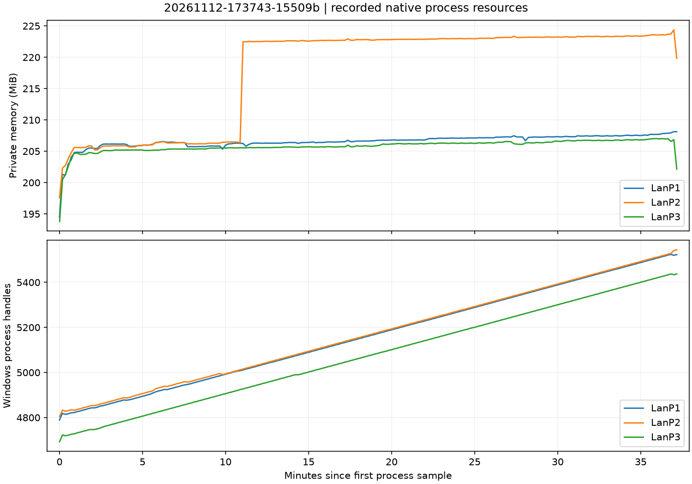
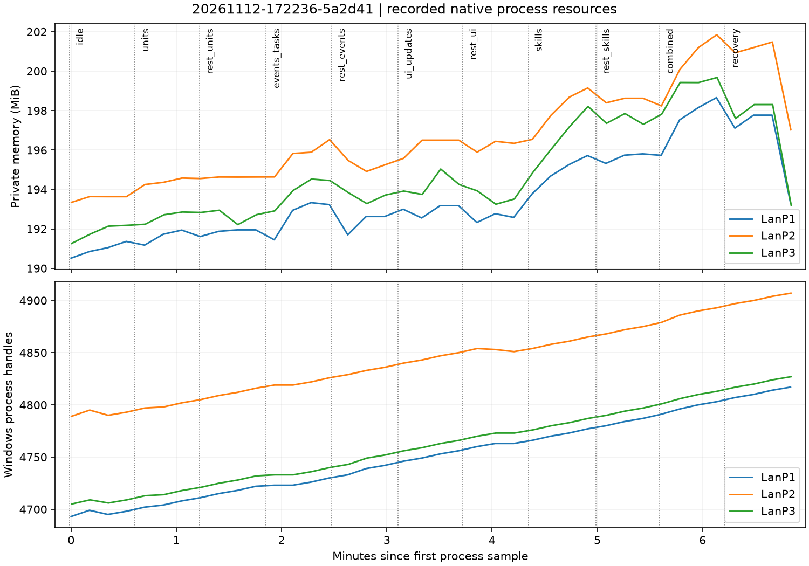
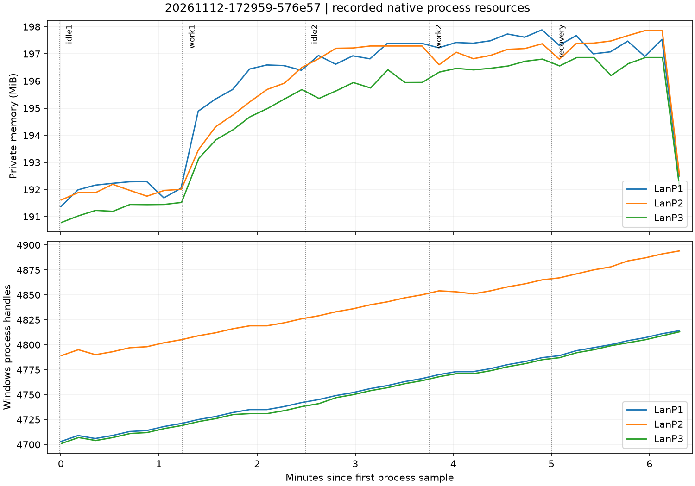
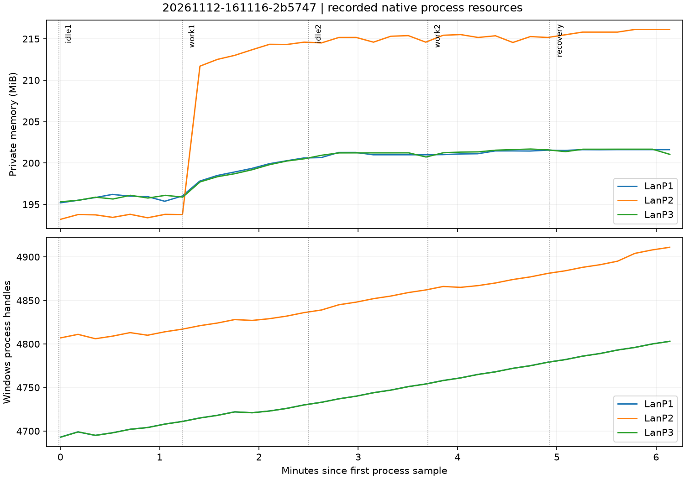

# 第二轮实机验证报告

日期：2026-11-12。状态：**最终源码的8项验收集合全部通过，包含预期OOS报警对照；证据独立核对通过**。下列 round2-final-* 是补齐前的中间证据，不能用于宣称后来源码已通过。完整范围固定在《第二轮已确认目标》，本报告与实现一并本地提交，不推送。

## 固定版本与交付范围

基于 Git `882be56` 开发。Warcraft 1.27.0.52240、InnerJAPI 1.49-9、Lua 5.3、handle_level=0；仍是一台机器的独立多进程 LAN，不是跨机/平台认证。当前公共运行库内容版本 `f08d7599b7b512f5ce694987a0564977e8bcf5a3b2e248a1eaaf059256f7c221`，113文件，版本由完整清单哈希决定；交付提交号见本报告所属Git提交。

新增三英雄业务目录、固定依赖、独立项目、MainMap/UnitTestMap LNI 构建、单位稳定 ID 与原生事件桥、技能事务、天赋、训练 Boss/挑战和官方 UI 命令面板。规则与 skill 同步修订，完整目录见《正式业务目录与技能样板》。不修改 MoeHero、魔灵降世、War3Lib 或 vendor 原包。

固定 w3x2lni 2.7.2 / `654f1a6ac5fff792be4c1760a8e11e8529107e9e`，完整安装文件、公开策略和核心策略分别锁定。使用项目私有缓存，不改共享安装。每个构建有 source map 哈希、工具策略哈希、最终 payload 清单和地图 SHA256。

## 最终源码验收集合

当前公共内容版本为 `f08d7599b7b512f5ce694987a0564977e8bcf5a3b2e248a1eaaf059256f7c221`。新增玩家退出策略、请求seq确认/本地未确认、目标复活与队列满载探针、11阶段资源矩阵，并修复保留取消token仍持有单位记录。离线负例和修复前源字节在 round2-build/unit-token-retention-before.log、unit-manager-before-token-fix.lua.txt、unit-token-regression.json；单/三/六端已验证原生token保留时记录可回收。

| 构建 | 会话 | 当前结果 |
| --- | --- | --- |
| round2-expanded-one-03 | 20261112-171256-8daedc | PASS，182断言、11轮摘要 |
| round2-expanded-three-01 | 20261112-171458-dd71e2 | PASS，每端284断言、11轮摘要 |
| round2-expanded-six-slk-01 | 20261112-171719-428e35 | PASS，MainMap SLK，每端437断言、11轮摘要 |
| round2-expanded-oos-01 | 20261112-172005-ccc775 | 预期FAIL，房主OOS检测、清理通过 |
| round2-expanded-ui-research-01 | 20261112-172049-0f4a45 | PASS，每端39断言、热更/性能回归 |
| round2-expanded-matrix-02 | 20261112-172236-5a2d41 | PASS，11阶段、12轮挑战、三类各118批负载 |
| round2-expanded-resource-01 | 20261112-172959-576e57 | PASS，两轮相同12次挑战，共24轮 |
| round2-expanded-long-01 | 20261112-173743-15509b | PASS，180000tick，每端354轮挑战、359轮摘要、6200断言，约37分15秒 |

最终短业务轮每端执行6轮挑战。单/三/六端分别处理76/228/456条命令，拒绝37/111/222条；原生特效累计创建26/74/146个，原生伤害调用114/340/679次，结束登记归零。多个客户端执行同一全局玩法，不能将这些全局计数再乘客户端数。三个英雄类型在1/3/6端分别有3/9/18个玩家英雄实例，配置共享、运行状态独立。

退出探针明确注入 `player_left` 通知，再验证真实原生单位/特效与任务清理，不冒充客户端真实断网。真正的EVENT_PLAYER_LEAVE已注册；分发身份与错误边界另有离线mock。界面序号关联、旧结果隔离、超时无重试、迟到拒绝与连续相同结果刷新通过专门离线回归；真实鼠标和像素仍需人工验收。

持久独立示例位于 `D:/War3/LuaScaffoldExample`，公共依赖锁定上述版本，66份运行时源码与本仓库相符。已完成离线、MainMap SLK与UnitTestMap OBJ构建，未单独启动此副本游戏；证据 independent-example.json。没有复制旧Git或历史实机evidence。

## 最终三端长测与资源结果

各端从BOOT到UT_DONE分别为2234.569、2234.515、2234.507秒，超过30分钟。每端354轮挑战、359轮状态摘要全部一致；全局业务命令4404、拒绝111、原生特效创建3206、伤害调用13264。UI本地负载分别7213/14416/21619轮；P1高频诊断GC与其他端不同，未进入同步决策。结束时业务登记、施法、任务、特效、UI及原生桥的清理断言通过，房主未报告正常场景OOS。

每端213次进程采样。下表保留全程及预先固定的“去掉最初5分钟”窗口；OLS是对全部采样点的拟合，不代表持续泄漏速度。

| 客户端 | 私有内存首末 MiB | 全程OLS MiB/分钟 | 5分钟后OLS MiB/分钟 | Windows句柄/分钟 |
| --- | --- | --- | --- | --- |
| P1 | 194.47→208.12 | 0.078 | 0.059 | 19.7 |
| P2 | 197.57→219.82 | 0.595 | 0.487 | 19.5 |
| P3 | 193.78→202.14 | 0.070 | 0.050 | 19.7 |

P2在17:49:02至17:49:12两个采样之间上升16.109MiB，之后进入缓慢增长区间，结束时部分回落；不能把包含这次跃升的斜率解释为匀速累积。来源未定位，也没有证据将其归因于已修复的取消token引用。补齐前长测与本轮分负载、重复工作对照已保留，用于说明复现差异，而非挑选最好曲线。

354个挑战结束采样点中，P1受控GC后的Lua堆为603.364–603.864KiB；P2正常GC采样范围952.456–2339.358KiB，P3为991.832–2411.668KiB，末次分别1088.697/1942.254KiB。各点业务任务/特效归零，单位恢复到10（9英雄+1借用对象）。不同GC策略的瞬时堆大小不可直接当泄漏对比。Windows句柄仍约+20/分钟，与空闲/分负载对照中的增长一致；它不是Warcraft handleID计数，仍保留未定位原生增长这一限制。

## 补齐前的中间构建与会话

| 构建 | 会话 | 人数/地图 | 结果 |
| --- | --- | --- | --- |
| round2-final-one | 20261112-162337-53b31b | 1 / UnitTestMap OBJ | PASS，136断言，11轮状态摘要 |
| round2-final-three | 20261112-162753-486140 | 3 / UnitTestMap OBJ | PASS，每端238断言、11轮摘要一致 |
| round2-final-six-slk | 20261112-162949-87b757 | 6 / MainMap SLK | PASS，每端391断言、11轮摘要一致 |
| round2-final-oos | 20261112-163158-182275 | 3 / 故意分叉 | 预期FAIL，房主 desync detected |
| round2-final-ui-research | 20261112-163254-311d95 | 3 / UI热更与性能 | PASS，每端39断言、9类各5次性能样本 |
| business-resource-01 | 20261112-161116-2b5747 | 3 / 五阶段资源对照 | PASS，两个12轮工作阶段，共24轮 |
| round2-final-long | 20261112-163457-4a1ba9 | 3 / 180000 tick业务压力 | PASS，每端354轮挑战、359轮摘要、6154断言；已清理，仍属补齐前源码 |

短业务轮每端执行6轮重复挑战。单/三/六端分别处理43/129/258条业务命令，拒绝4/12/24条；创建26/74/146个施法特效，最终归零。六端每端原生伤害调用677次。每个客户端模拟同一全局玩法，不把这些数再乘人数当作地图内容规模。

所有终止会话均检查每端日志、房主检测和按PID/创建时间的清理。`tests/evidence/acceptance-round2.json` 明确最终集合，`tools/verify_round2.py` 要求当前源码、两图源、工具策略与证据一致；旧轮报告保持历史身份。

上述中间长测约37分钟：各端全局命令4305、拒绝12、施法特效创建3206、伤害调用13261；各端UI循环7213/14416/21619，保留差异本地负载。进程采样213/213/214次，私有内存首末约191.67→204.93、192.50→206.29、197.57→219.48 MiB；全程OLS斜率约0.067/0.074/0.217 MiB每分钟，Windows句柄约+19.5至19.8每分钟。初始加载会影响全程斜率，不能仅凭这些数归因泄漏。数据与图保留在该会话目录；最终补齐源码仍须另测。

## 原生覆盖与异常矩阵

- 地图预放置的类型、玩家、位置和区域读回；三英雄物编名称；初始化全端一次。
- 死亡/复活、主动移除、外部原生移除、借用/拥有、变身/变熊、召唤和所有权改变；稳定ID不复用，生命周期epoch使旧任务失效。
- 100批×20单位、每批间隔10tick：最终单/三/六端分别观察1974/1966/1954次原生handle重复。该数只诊断，不参与同步决策，也不要求各端相同。
- 本地官方UI事件入口经原生同步消息选择天赋、开始挑战和施法；读取真实发送者，三英雄原生伤害击杀Boss，结算一次。
- 原生传输拒绝重复/过期、非规范整数、无效字段、超长和未知命令；业务拒绝越权及旧目标。被拒的重复挑战请求不恢复生命/能量。
- 施法途中死亡、目标移除、控制权转移、原生形态变化中断任务/特效；原生死亡事件重入后不继续安排伤害。挑战退出复活英雄并保持稳定ID。
- 在真实原生特效已分配后注入任务准备错误，确认销毁特效且不提交能量/冷却。此项是明确注入的失败，不是引擎随机故障。
- 最终停止清理挑战、技能、单位、UI和共享原生计时/消息桥；检查Lua侧登记与拥有资源归零。

纯离线额外覆盖强制handle复用、目标移出范围、捕获引用释放、施法准备失败、全灭/超时、Boss准备失败、初始化中途失败及清理错误后继续释放、原生事件回调异常后静默后续派发与显式销毁。离线模拟不宣称已验证引擎的所有异常路径。

## 构建与模板验收

最终两图检查7个物编对象950个有效字段，OBJ/SLK都做解析语义对比；浮点允许受限存储误差，整数精确。逐字节回读Lua/载体/资产、地形、路径、阴影、预放置和区域，最终JASS通过经典检查器。

负例修改英雄名称被物编校验拒绝；缺少成功构建清单、地图SHA不符、客户端数不符均在启动前拒绝。`build-negative.json` 明确 `game_launched=false`。

独立临时新项目完成离线与正式MainMap构建，正式包72文件，排除runtime_test、旧测试UI、probes/dev和load解码器。复制不带旧Git/build/evidence。固定依赖A→B→A完成3次实际构建及Lua版本探针检查，篡改现包、额外文件、坏新包拒绝且锁不变。该版本探针是合成升级实验，没有把它冒充真实新版本游戏验证。

## 当前源码的资源对照

两类对照均为三端，固定逻辑tick和工作量；每端记录Lua堆、单位、任务、事件、控件与原生特效登记，运行器独立采样进程。阶段开始的全量GC用于观察引用保留，正式玩法不周期性全量GC；不能用这些诊断GC的耗时代表正常游戏性能。

11阶段矩阵依次为：空闲、单位、恢复、事件/任务、恢复、UI更新、恢复、技能、恢复、组合、最终恢复。每阶段3000tick，总33000tick，实测约411秒。独立工作阶段及组合阶段分别执行59批：每批20单位、100事件和100任务、30文本及1面板；总计2360单位、11800事件/任务、3540文本和118面板创建清理。技能阶段及组合阶段各6轮挑战，共12轮。每个阶段边界无探针任务/事件残留，结束服务、原生桥及UI登记归零。

| 阶段 | P1私有内存 MiB | P2私有内存 MiB | P3私有内存 MiB |
| --- | --- | --- | --- |
| 空闲 | 190.52→191.36 | 193.34→193.64 | 191.26→192.18 |
| 单位 | 191.18→191.94 | 194.25→194.58 | 192.23→192.86 |
| 事件/任务 | 191.45→193.23 | 194.64→196.53 | 192.91→194.45 |
| UI更新 | 193.00→193.18 | 195.58→196.50 | 193.92→194.25 |
| 技能 | 193.78→195.72 | 196.54→199.15 | 194.86→198.21 |
| 组合 | 195.73→198.66 | 198.24→201.85 | 197.82→199.68 |
| 最终恢复 | 197.11→193.32 | 200.93→197.03 | 197.60→193.20 |

矩阵每阶段只有3–4个进程采样，不能把短段斜率当泄漏率。Lua堆在工作时正常涨落；P1阶段GC后约545–557KiB，活动任务/事件数可以升至100但随后回归零。最终恢复包含应用结束清理，内存回落不能单独归因GC或某个原生对象。完整恢复阶段和各端数据见该会话 resource-summary.json 与原始日志。

重复业务对照每阶段6000tick，总30000tick，约377秒。两个工作阶段各12轮相同挑战。基线9英雄、1借用单位、46控件；初始化任务结束后UI任务为2。阶段边界没有活动施法/特效/挑战，两个工作阶段后受控GC的P1 Lua堆约547.2/546.8KiB，未表现为每轮等幅保留；最终清理归零。

| 阶段 | P1私有内存 MiB | P2私有内存 MiB | P3私有内存 MiB |
| --- | --- | --- | --- |
| idle1 | 191.37→192.05 | 191.61→192.01 | 190.79→191.52 |
| work1 | 194.89→196.39 | 193.47→196.49 | 193.14→195.68 |
| idle2 | 196.94→197.39 | 196.82→197.29 | 195.36→195.95 |
| work2 | 197.22→197.88 | 196.60→197.37 | 196.33→196.80 |
| recovery | 197.32→192.50 | 196.80→192.53 | 196.55→192.04 |

每格是阶段首末采样而非精确边界，每阶段7–8点。第二轮工作增长小于第一轮，最终内存回落。Windows进程句柄在空闲及恢复仍约+20/分钟，两个对照均未将其定位到特定业务类别。这不等于Warcraft handle泄漏，也不是原生零泄漏证明；继续保留未定位的增长，不以Lua计数归零掩盖它。

## 补齐前的五阶段资源对照（历史）

`business-resource-01` 每阶段6000tick，总30000tick，约370秒。基线含9英雄、1借用单位、46控件；两轮各12次挑战，同样工作量。边界无活动挑战/施法/特效/单位任务，最终所有服务和UI停止。阶段边界的全量GC只为实验，正式游戏不采用此策略。

| 阶段 | P1私有内存 MiB | P2私有内存 MiB | P3私有内存 MiB |
| --- | --- | --- | --- |
| idle1 | 195.19→196.01 | 193.20→193.79 | 195.32→196.09 |
| work1 | 197.80→200.61 | 193.76→214.60 | 195.88→200.51 |
| idle2 | 200.65→200.99 | 214.51→214.60 | 200.94→200.72 |
| work2 | 201.01→201.55 | 215.43→215.16 | 201.24→201.59 |
| recovery | 201.52→201.61 | 215.49→216.13 | 201.37→201.04 |

每格是该阶段首末进程采样，不是精确边界值；每段7–8个样本。第一次工作增长明显，第二轮同负载增长较小，空闲/恢复总体趋平。支持“此短对照未出现两次等幅累积增长”，不能证明无泄漏、确定缓存来源或解释P2额外增长。恢复阶段回归斜率约0.06/0.59/-0.20 MiB每分钟，样本较短。

Windows进程句柄在idle2就约+20/分钟，恢复阶段约+20/+27/+20每分钟，不能据此归因技能的Warcraft handle泄漏。它与引擎handle ID不是同一指标，历史空闲对照也出现增长。原始资源样本、OLS统计和图在该会话的 `resources.jsonl`、`resource-summary.json`、`resource-trends.png/svg`。统计脚本 `tools/summarize_resources.py` 可重算，不做因果归因。

## 研究中失败与修正

原始失败全部保留，不改写为PASS：RemoveUnit同回调仍返回旧类型；自定义变身未永久保留技能导致最终类型不符；单回调2000单位工作使状态收集超时；物编校验失败后的残留地图被旧入口启动（已修门禁）；中止与运行器finally清理竞争锁（保留首次失败、待退出后按原身份重试）。具体会话与修订见《单位生命周期与handle复用》《固定依赖与LNI构建》和 acceptance-round2 的解释表。

w3x2lni CLI退出码不足以证明成功，私有策略必须落实实际读取路径；computed_text不在公开选项白名单，需要固定私有核心策略。SLK不能假定存在war3map.w3u。OBJ浮点字符串与TXT空/缺省值采用限定语义对比，不扩大为忽略所有差异。

## 未覆盖与最终验收

真实鼠标/键盘、输入法、裁剪像素、分辨率外观未人工验收；UI自动派发与原生属性读回不等于视觉证明。跨机/平台、断线重连、观战/回放、平台交易、任意外部JASS触发器、其他运行时版本不在本轮保证中。整个应用不支持一局内重启，只支持受控本地view热更。

`tools/verify_round2.py` 已生成 `tests/evidence/verified-round2.json`：65份实际运行时源（排除构建时生成配置）、两图源、工具策略、每端摘要/业务计数、最终长测时长、故意OOS及全部59场已记录会话清理核对通过。独立示例另核对全部66份src文件；升级实验的A/B内容身份由当前公共源码重新计算匹配。离线、PowerShell/tasks、skill与Git原始字节检查通过。

全局游戏目录jass2binary恢复SHA256为 `61642441cfeaba50c7d73323162f5dfc3d8112c05fe05305fa6090fb6f204126`，没有未完成的runtime-guard journal。失败原始记录与历史基线保留，不以本报告改写为成功。本地提交包含实现、规则、skill、文档及原始证据，不推送。
